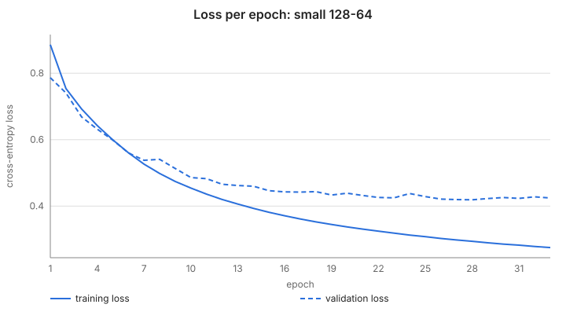
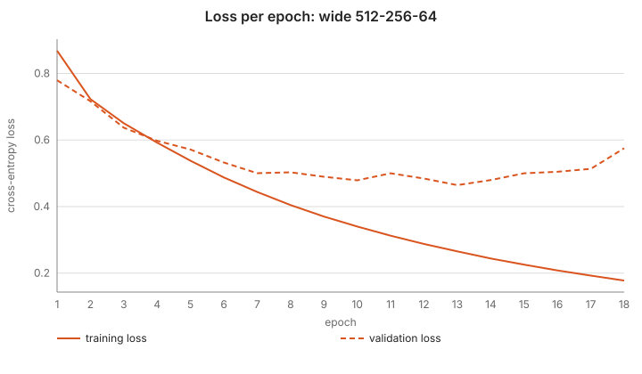
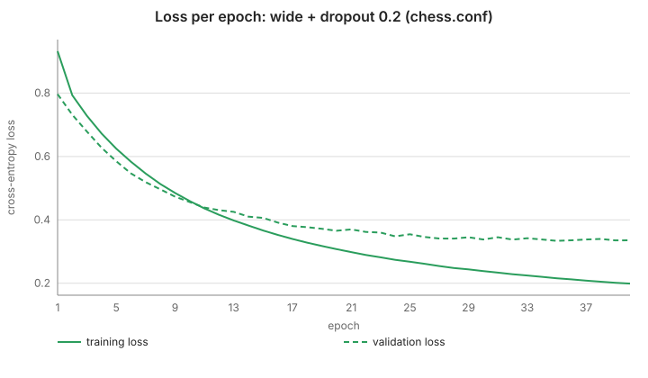
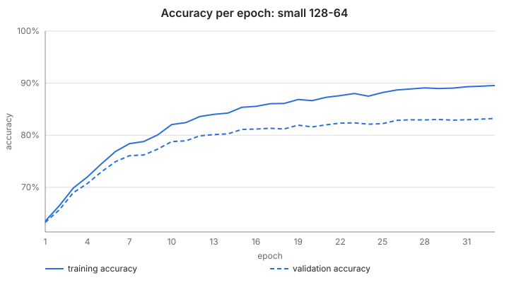
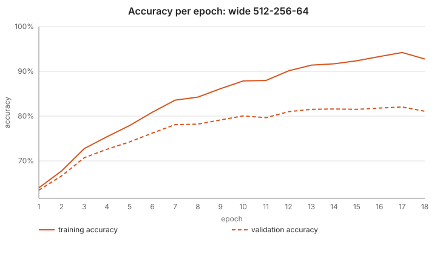
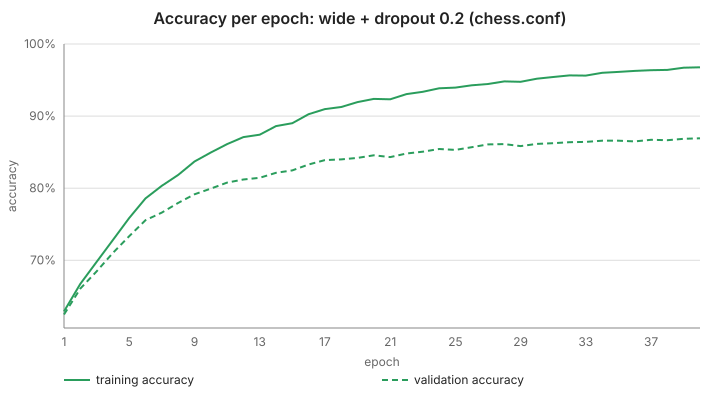
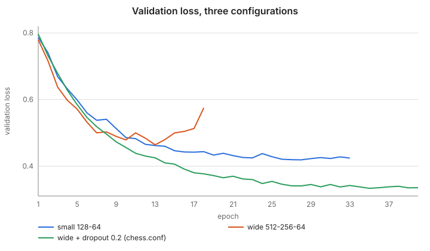
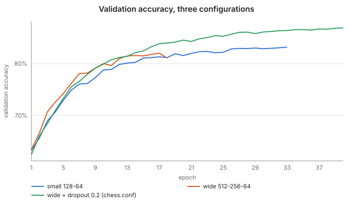
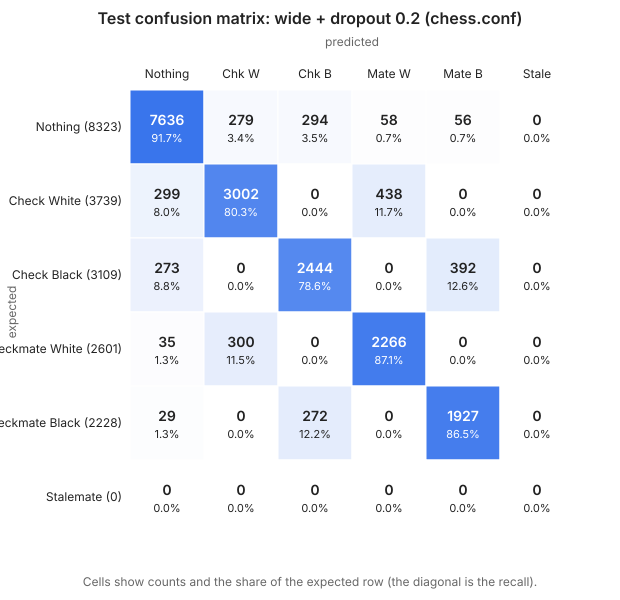
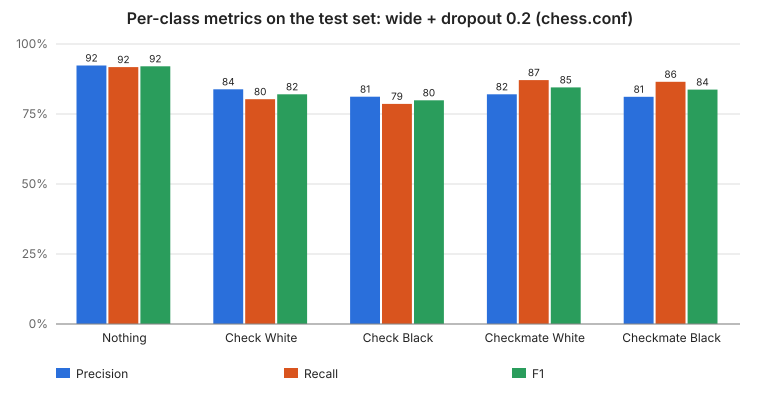

# Benchmarks

Measured results of the chess network: learning curves, confusion matrix, per-class metrics and a comparison of
three configurations. Every number and image here is produced by [`scripts/benchmark.py`](../scripts/benchmark.py)
from the analyzer's own output (the curves are read from the `--dashboard` endpoint, the test predictions come
from `--predict`). The raw numbers are in [`benchmarks/results.json`](benchmarks/results.json).

## Protocol

- **Data**: `dataset/full.txt` (723,019 positions, see [dataset.md](dataset.md)), deduplicated and shuffled with a
  fixed seed. **20,000 positions are held out as a test set** that no training ever sees; the next **700,000** are
  the training set (the analyzer then holds out 10 % of them as the validation split for early stopping).
  The two sets never overlap.
- **Training**: `--train` with `--dashboard`, no `--mirror`, SGD with learning rate 0.05, batch size 128, seed 42,
  early stopping on the validation loss with patience 5, at most 60 epochs. Only the layers change between runs.
- **Metrics**: accuracy, per-class precision / recall / F1 and macro-F1 on the test set. Macro-F1 skips `Stalemate`,
  which has no sample in the dataset.
- **Baseline**: always answering `Nothing` gives **41.6 %** accuracy on the test set. Every network must beat it.
- Machine: one CPU run per configuration, single training process (times below are wall-clock and only indicative).

## Results

| Configuration | Epochs run (best) | Train acc. at best | Validation acc. at best | Test accuracy | Test macro-F1 | Time |
|---|---|---|---|---|---|---|
| small: 128-64 | 33 (28) | 89.1 % | 82.9 % | 83.2 % | 0.811 | 146 s |
| wide: 512-256-64 | 18 (13) | 91.4 % | 81.5 % | 81.5 % | 0.796 | 353 s |
| **wide + dropout 0.2 (`configs/chess.conf`)** | 40 (35) | 96.1 % | 86.6 % | **86.4 %** | **0.844** | 573 s |

Validation and test accuracy agree within 0.3 points, so the early-stopping split gives an honest estimate here and
the model was not tuned on the test set. All three networks are far above the 41.6 % baseline.

### Learning curves

The solid line is the training set, the dashed line the validation split. The training accuracy is measured on the
whole training set after each epoch.

| Small 128-64 | Wide 512-256-64 | Wide + dropout (chess.conf) |
|---|---|---|
|  |  |  |
|  |  |  |

Reading them (see [training-metrics.md](training-metrics.md) for the diagnosis table):

- **Wide, no dropout, overfits fast.** Its validation loss is lowest at epoch 13 (0.464) and then rises to 0.575 at
  epoch 18 while the training loss keeps falling to 0.178: the textbook overfitting pattern. Early stopping stops it.
- **Small is stable but limited.** Training and validation loss both flatten out (validation loss 0.419 at best); more
  capacity is needed to go further, but capacity alone hurts (previous point).
- **Dropout fixes the wide network.** The validation loss keeps decreasing for 35 epochs down to 0.334 and the
  validation accuracy ends 4 points above the small network.
- **A gap remains.** With dropout, training accuracy is still about 10 points above validation accuracy (96.1 % against
  86.6 %). The network still partly memorises, so more data or other regularisation could help. This is not solved.

### Comparison on one graph




### Confusion matrix (test set, `configs/chess.conf`)



Rows are the expected labels, columns the predictions. The other two configurations are in
[confusion-small-128-64.svg](benchmarks/confusion-small-128-64.svg) and
[confusion-wide-512-256-64.svg](benchmarks/confusion-wide-512-256-64.svg).

The errors have a clear structure:

- A **check is confused with the checkmate of the same color** (299 `Check White` predicted `Checkmate White`, 438 the
  other way round; same for black) or with `Nothing`. Telling a mate from a check requires knowing that the king has
  no escape, which is a search over moves, hard to infer from a plane of 769 inputs.
- A check is **never** predicted as the opposite color's check or mate: those cells are 0, because a prediction can
  never name the side to move as the attacker.

### Per-class metrics (test set, `configs/chess.conf`)



| Label | Test samples | Precision | Recall | F1 |
|---|---|---|---|---|
| Nothing | 8,323 | 92.3 % | 91.7 % | 0.920 |
| Check White | 3,739 | 83.8 % | 80.3 % | 0.820 |
| Check Black | 3,109 | 81.2 % | 78.6 % | 0.799 |
| Checkmate White | 2,601 | 82.0 % | 87.1 % | 0.845 |
| Checkmate Black | 2,228 | 81.1 % | 86.5 % | 0.837 |
| Stalemate | 0 | n/a | n/a | n/a |

## Limits (read before quoting a number)

- **Stalemate is not measured.** The dataset contains no stalemate position, so the network was never trained or
  tested on that label; nothing here says how well it would recognise one.
- One seed per configuration: differences of one or two points between runs could be noise. The ranking
  (dropout > small > wide) is large enough, 3 to 5 points, to be believable, but the gap between small and wide
  without dropout is not.
- Only the three configurations above were compared. This is not a hyperparameter search.
- The committed `my_torch_network.nn` was trained on the whole dataset (with `--mirror`), so it cannot be evaluated
  on this test set without leaking; the figures above come from networks trained for this benchmark.
- The test set has the same distribution as the training data (positions of one generator); results on other sources
  of positions are not measured.

## Regenerate

```sh
make                                              # builds the binaries in target/release
python3 scripts/benchmark.py --dataset dataset/full.txt --workdir /tmp/bench --epochs 60 --train-size 700000
```

The script uses only the Python 3 standard library and writes the SVG files and `results.json` into
`docs/benchmarks/`. Options: `--train-size`, `--test-size`, `--epochs`, `--out`. The full run takes about
18 minutes; `--train-size 100000` takes about 2 minutes but gives different (lower) numbers. The training is seeded,
so a rerun gives the same numbers on the same machine.
